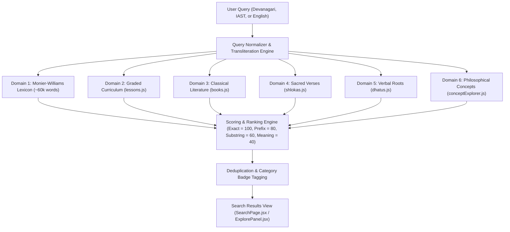
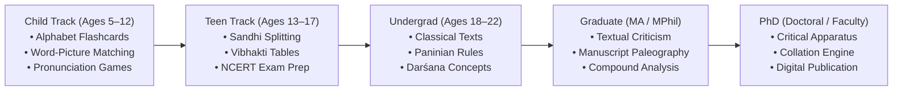

# संस्कृतम् — SanskritLab System Architecture

**Comprehensive Architectural Blueprint, Technical Stack, and Design Specifications**

---

## 1. Executive Summary & Design Principles

SanskritLab is an offline-first, dual-engine computational platform designed to support the entire spectrum of Sanskrit learning and research — spanning from early childhood play modes to doctoral critical editions.

```
┌────────────────────────────────────────────────────────────────────────┐
│                              CLIENT TIER                                │
│   React 19 SPA (Vite)  ·  PySide6 Desktop App  ·  Three.js 3D Canvas    │
└───────────────────▲────────────────────────────────▲───────────────────┘
                    │                                │
                    ▼                                ▼
┌──────────────────────────────────────┐  ┌──────────────────────────────┐
│       NATIVE BACKEND ENGINE          │  │     OFFLINE LINGUISTIC       │
│  Actix-Web 4 (Rust) · Tokio Runtime  │  │        DATA TIER             │
│  OCR · Sandhi · Viva · Morph Parse   │  │  60k Monier-Williams Lexicon │
│  High-Throughput Native Binary       │  │  Books · Shlokas · Dhatus    │
└───────────────────▲──────────────────┘  └──────────────────────────────┘
                    │
                    ▼
┌──────────────────────────────────────┐
│         CLOUD PERSISTENCE            │
│   Supabase (PostgreSQL + RLS)        │
│   (Graceful Offline Fallback)        │
└──────────────────────────────────────┘
```

### Core Architectural Principles
1. **Offline-First Resilience**: All core linguistic capabilities — including the 59,995-word Monier-Williams lexicon, Varna categorization, universal search, curriculum lessons, classical literature, and shloka recitation — operate 100% offline without requiring internet or cloud credentials.
2. **Dual-Tier Compute**: High-performance, memory-safe Rust native backend (`actix-web 4`) handles CPU-intensive linguistic operations (compound splitting, phonetic sandhi, OCR, audio synthesis), while client-side JavaScript provides instant local caching and sub-millisecond UI reactivity.
3. **Multi-Track Persona Engine**: Dynamic runtime reconfiguration based on user persona (Child: ages 5–12, Teen: ages 13–17, Undergrad: ages 18–22, Graduate: MA/MPhil, PhD: researchers, and Teachers/Institutions).
4. **Zero-Lock Cloud Decoupling**: Supabase cloud queries are strictly guarded with network timeouts and local fallbacks, guaranteeing zero application hangs when offline or unconfigured.

---

## 2. System Architecture & High-Level Data Flow

```mermaid
graph TB
    subgraph Client ["Client Presentation Tier (Browser / Desktop)"]
        UI[React 19 SPA]
        Router[React Router v7]
        State[LanguageContext & RoleContext]
        ThreeJS[Three.js 3D Palm-Leaf Canvas]
        Audio[Web Speech API & Audio Recitation Engine]
        OCR_Client[Tesseract.js Client OCR]
    end

    subgraph OfflineEngine ["Client-Side Linguistic Engines (Zero Network)"]
        MW_Lexicon["Monier-Williams In-Memory Store (~60k words)"]
        Varna_Index["Varna Phonetic Classifier (44 Letters)"]
        Universal_Search["Sanskrit Khoj Engine (searchAll)"]
        Static_Data["Curriculum, Shlokas, Books, Dhatus"]
    end

    subgraph RustBackend ["Native Backend Engine (http://127.0.0.1:8080)"]
        ActixRouter["Actix-Web REST Server"]
        RustGrammar["Grammar Parser & Sandhi Splitter"]
        RustCorpus["Corpus Full-Text Indexer"]
        RustDict["Native Dictionary & Compound Splitter"]
        RustViva["AI Viva Examiner Simulator"]
        RustOCR["Native Neural OCR Engine"]
    end

    subgraph Persistence ["Persistence & Cloud Tier"]
        LocalStorage["Browser LocalStorage & IndexedDB"]
        Supabase["Supabase Cloud PostgreSQL (Optional)"]
    end

    UI --> Router
    Router --> Universal_Search
    Universal_Search --> MW_Lexicon
    Universal_Search --> Varna_Index
    Universal_Search --> Static_Data
    UI --> State
    UI --> ThreeJS
    UI --> Audio
    UI --> LocalStorage

    UI -. Optional RPC .-> ActixRouter
    ActixRouter --> RustGrammar
    ActixRouter --> RustCorpus
    ActixRouter --> RustDict
    ActixRouter --> RustViva
    ActixRouter --> RustOCR

    UI -. Optional Cloud Sync .-> Supabase
```



---

## 3. Technology Stack Breakdown

| Layer | Technologies & Libraries | Architectural Role |
|---|---|---|
| **Frontend Framework** | **React 19.2**, **Vite 8.1** | Modern component architecture, sub-second HMR, tree-shaking, ES modules. |
| **Routing** | **React Router v7.18** | Client-side SPA routing, dynamic route parameters, query string synchronization. |
| **Styling & Design System** | **Vanilla CSS Tokens (`App.css`)** | Custom design system using CSS variables, dark/light theme switching, fluid typography, glassmorphism. |
| **3D Rendering** | **Three.js 0.185**, **OrbitControls** | Interactive 3D visualization of physical palm-leaf manuscripts and branching rule maps. |
| **OCR & Document Processing**| **Tesseract.js 7.0**, **PDF.js 4.10** | Client-side scanned Devanāgarī and Grantha manuscript extraction; textbook rendering. |
| **Icons & Visuals** | **Lucide React 1.38** | Standardized, accessible SVG iconography. |
| **Unit & Integration Testing**| **Vitest 4.1**, **JSDOM 29.1** | Fast in-memory unit testing for linguistic services, lexical searches, and curriculum integrity. |
| **Native Backend Server** | **Rust (Actix-Web 4, Tokio, Serde)** | Native binary REST API providing microsecond grammar parsing, corpus exploration, and assessment generation. |
| **Desktop Shell** | **Python 3.10+, PySide6 (Qt6)** | Multi-window desktop application with embedded native controls and backend integration. |
| **Cloud Database** | **Supabase (PostgreSQL 15, RLS)** | Optional remote storage for user profiles, classroom assignments, and corpus sync. |
| **Deployment / CI** | **Vercel SPA + Edge/Serverless, Vite Build** | Zero-config continuous deployment with `vercel.json` rewrites (`/(.*) -> /index.html`), asset caching headers, and `.github/workflows/vercel.yml` CI/CD. |

---

## 4. Frontend Architecture & Modular Organization

The frontend codebase is organized under `client/src/` by functional responsibility:

```
client/src/
├── components/          # Reusable shared UI primitives
│   ├── Layout.jsx       # Global header, navigation, and persistent footer
│   ├── ExplorePanel.jsx # Deep-dive word modal (morphology, definitions, citations)
│   ├── ShlokaRecitationSection.jsx # Audio recitation player & meter visualizer
│   ├── SchoolOnly.jsx   # Institutional feature authorization wrapper
│   └── icons.jsx        # Dynamic icon registry
├── context/             # Global application state providers
│   ├── LanguageContext.jsx # Bilingual English (en) / Hindi (hi) i18n switcher
│   └── RoleContext.jsx  # Active user role & curriculum track switcher
├── data/                # Static & pre-indexed linguistic databases
│   ├── monier_core.json # 59,995-entry Monier-Williams Sanskrit-English lexicon
│   ├── lessons.js       # Graded curriculum units (levels 0 to 5)
│   ├── books.js         # Classical literature (Gita, Ramayana, Hitopadesha, etc.)
│   ├── shlokas.js       # 70+ verses across 10 canonical scriptures with meters, audio, and translations
│   ├── dhatus.js        # Verbal roots with gaṇa, pada, and meanings
│   ├── conceptExplorer.js # Indian philosophical darśanas and definitions
│   ├── tracks.js        # Progression metadata (Child → PhD)
│   └── ncertData.js     # NCERT classes 6–12 Sanskrit textbooks
├── pages/               # Route-level view controllers
│   ├── dashboard/       # Institutional home, hero banner, program directory
│   ├── tools/           # Sanskrit Shlokas (/tools/shloka), Lexicon, Sandhi, Dhatus, Etymology, Jeopardy
│   ├── research/        # Manuscript OCR, historical corpus, critical apparatus
│   ├── learning/        # Lessons, gamified skill tree, assessment, Jeopardy
│   ├── viva/            # AI oral examiner, language pronunciation lab
│   ├── teaching/        # Teacher, institution, and student dashboards
│   └── visualization/   # 3D palm-leaf reader and evolutionary timeline
└── services/            # Pure linguistic algorithms & API adapters
    ├── sanskrit.js      # Transliteration, sandhi rules, multi-entity searchAll
    ├── api.js           # Client for native Rust backend engine
    ├── supabase.js      # Supabase cloud client with offline guards
    ├── speech.js        # Web Speech API TTS wrapper with fallbacks
    └── localStore.js    # LocalStorage / IndexedDB persistence layer
```

---

## 5. Linguistic Engine & Offline Data Pipeline

### 5.1 Universal Search Architecture (Sanskrit Khoj — `searchAll`)
The `searchAll` engine ([client/src/services/sanskrit.js](file:///d:/Projects/sanskrit/client/src/services/sanskrit.js)) provides synchronous/asynchronous multi-entity discovery across 6 discrete data domains without network latency:



### 5.2 Monier-Williams Varna Indexing Engine
The Monier-Williams lexicon ([client/src/pages/tools/DictionaryPage.jsx](file:///d:/Projects/sanskrit/client/src/pages/tools/DictionaryPage.jsx)) indexes all 59,995 words into 44 traditional Sanskrit Varna (alphabet) buckets in ~6 milliseconds:

1. **Phonetic Categorization**:
   - **स्वराः (Vowels)**: `अ`, `आ`, `इ`, `ई`, `उ`, `ऊ`, `ऋ`, `ऌ`, `ए`, `ऐ`, `ओ`, `औ`
   - **क-वर्गः (Velars)**: `क`, `ख`, `ग`, `घ`, `ङ`
   - **च-वर्गः (Palatals)**: `च`, `छ`, `ज`, `झ`, `ञ`
   - **ट-वर्गः (Retroflex)**: `ट`, `ठ`, `ड`, `ढ`, `ण`
   - **त-वर्गः (Dentals)**: `त`, `थ`, `द`, `ध`, `न`
   - **प-वर्गः (Labials)**: `प`, `फ`, `ब`, `भ`, `म`
   - **अन्तःस्थाः (Semivowels)**: `य`, `र`, `ल`, `व`
   - **ऊष्माणः (Sibilants & Aspirate)**: `श`, `ष`, `स`, `ह`
2. **Progressive Batch Rendering**:
   Words are displayed in configurable page batches (30, 60, 120, 240) with fast bidirectional pagination, preventing DOM freeze while guaranteeing 100% of the dictionary is navigable.

---

## 6. Native Backend Engine (Rust Actix-Web)

The backend engine resides in `backend/rust/` and runs on `http://127.0.0.1:8080`. Built with Actix-Web 4 and Tokio, it delivers multi-threaded performance for heavy linguistic and analytical tasks:

```
backend/rust/src/
├── main.rs          # Server entrypoint, CORS configuration, route registry
├── ocr.rs           # Neural optical character recognition pipeline
├── grammar.rs       # Paninian sandhi splitting, joining, and morphology rules
├── corpus.rs        # In-memory full-text index across historical corpus
├── dictionary.rs   # Compound decomposition and etymology resolution
├── assessment.rs   # Procedural drill and quiz generator
├── viva.rs         # Oral examiner AI simulator & rubric evaluator
└── tts.rs          # Vedic phoneme synthesis and audio streaming
```

### Key API Endpoints
- `GET  /api/health` — System status, uptime, and active computational modules.
- `POST /api/grammar/sandhi` — Deterministic Paninian Sandhi rule segmentation.
- `POST /api/grammar/sandhi-join` — Sandhi rule combinator.
- `GET  /api/corpus/search?q={query}` — High-speed regex and lemma search across historical corpus.
- `POST /api/dictionary/compound-split` — Recursive Samāsa (compound) segmenter.
- `POST /api/viva/session` & `/evaluate` — Real-time oral examination session manager.

---

## 7. Desktop Shell Architecture (PySide6)

The optional native desktop application ([desktop/main.py](file:///d:/Projects/sanskrit/desktop/main.py)) wraps SanskritLab into an installable desktop program:
- **Framework**: Python 3.10+ with Qt6 bindings (`PySide6`).
- **Communication**: Native HTTP requests to `http://127.0.0.1:8080`.
- **Capabilities**: Local filesystem manuscript import, direct printer integration, and offline workspace persistence.

---

## 8. Adaptive Learning Track Architecture

SanskritLab dynamically structures content across 5 developmental tracks:



---

## 9. Security, Offline Reliability, and Performance

### 9.1 Offline Fallback & Graceful Degradation
- **Guarded Cloud Connections**: Every network request to external services (such as Supabase) is wrapped with `import.meta.env?.VITE_SUPABASE_URL` checks and timeout races (`Promise.race([query, timeout])`). If offline or unconfigured, the application falls back immediately to local datasets within < 25ms.
- **Client-Side Lexicon Caching**: Dynamic imports ensure the 12 MB Monier-Williams database is loaded once into browser memory and indexed for the duration of the user's session.

### 9.2 Content Security & Data Isolation
- **Row-Level Security (RLS)**: If Supabase is enabled, PostgreSQL security policies enforce that students, teachers, and institutions only read and write their authorized data partitions.
- **Sanitized Execution**: All transliterations, scripts, and inputs are processed through deterministic pure functions without `eval()` or unescaped HTML injection.

---

## 10. Development & Deployment Workflows

### 10.1 Local Execution
- **One-Click Startup**: Running [run.bat](file:///d:/Projects/sanskrit/run.bat) boots the Rust backend on port `8080` and the Vite frontend on port `5173`.
- **Manual Startup**:
  - Backend: `cd backend/rust && cargo run`
  - Frontend: `cd client && npm run dev`
  - Unit Tests: `cd client && npm test` (Vitest test suite)

### 10.2 Production Deployment (Vercel SPA & Serverless)
- The frontend builds cleanly via `npm run build` into `client/dist`.
- Static routing rules and caching are enforced via [vercel.json](file:///d:/Projects/sanskrit/vercel.json) and [client/vercel.json](file:///d:/Projects/sanskrit/client/vercel.json):
  ```json
  {
    "$schema": "https://openapi.vercel.sh/vercel.json",
    "framework": "vite",
    "cleanUrls": true,
    "rewrites": [
      { "source": "/api/(.*)", "destination": "/api/$1" },
      { "source": "/(.*)", "destination": "/index.html" }
    ],
    "headers": [
      {
        "source": "/assets/(.*)",
        "headers": [
          {
            "key": "Cache-Control",
            "value": "public, max-age=31536000, immutable"
          }
        ]
      }
    ]
  }
  ```
- Automated preview and production deployments are managed via [.github/workflows/vercel.yml](file:///d:/Projects/sanskrit/.github/workflows/vercel.yml) targeting scope `riddhimaan-singh`.
